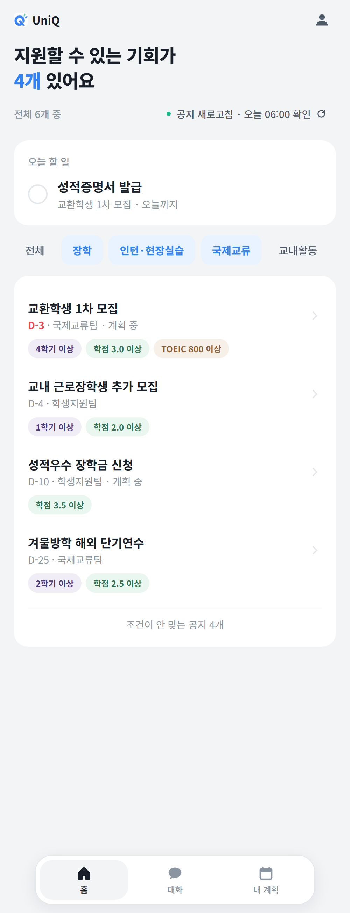
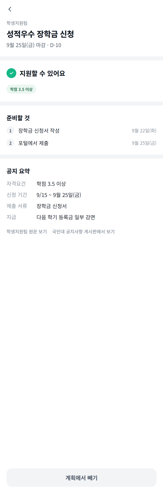
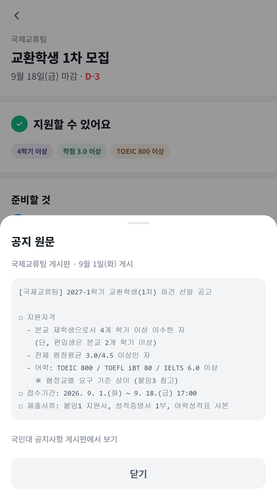
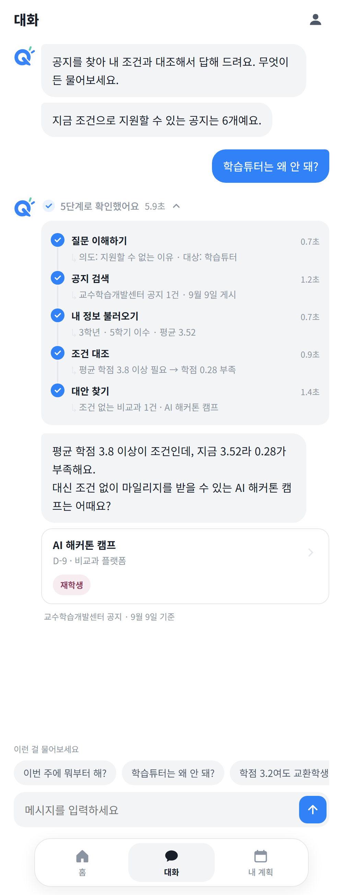
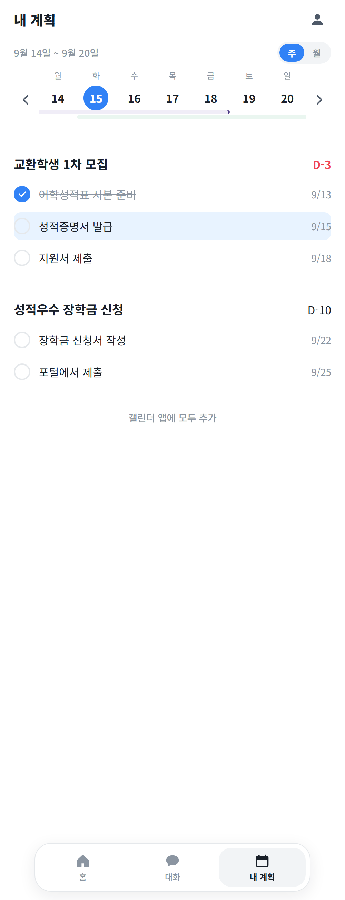

# UniQ — 국민대 공지 통합 에이전트

> 흩어진 학교 공지 중에서 **내 조건으로 지금 지원할 수 있는 것만**, 근거 문장과 함께 보여주는 서비스

2026 국민대학교 캠퍼스타운 키로톤(AI 바이브코딩 해커톤) · 15팀 · 4인 팀 프로젝트

<p>
  
  
  
  
  
</p>

> 대회 서버는 대회 기간에만 운영해서 지금은 라이브 데모가 없습니다. 화면은 [`docs/ui-screens/`](docs/ui-screens/)의 스크린샷 28장으로 볼 수 있습니다.

---

## 내 역할

4명 중 **기획·문제 정의, 사용자 리서치(인터뷰·사용성 테스트), 데이터 수집·분석**을 중심으로 맡았습니다. UI 디자인·프론트엔드와 발표도 맡았습니다.

| 영역 | 한 일 |
|---|---|
| **기획·문제 정의** | 문제를 학생, 부서, 데이터 세 방향에서 검증하는 방법을 설계함. 기존 서비스 3개를 분석해 차별점을 "모아 보기"에서 "지원 가능 여부 판정"으로 정함. 기능 범위, 데모 시나리오, 수집 방식의 비용을 비교해 정함 |
| **사용자 리서치** | 인터뷰 질문지와 사용성 테스트 과제를 설계함. 학생 유형별 인터뷰, 재학생 5명 대상 사용성 테스트, 부서 담당자 인터뷰 2곳, 담당 부서 전화 확인을 진행함 |
| **데이터 수집·분석** | 국민대 도메인 75개와 공지 게시판 150개를 직접 찾아 셈. 그중 30곳을 골라 **Claude Code로 크롤링**해 공지 939건과 첨부 224개를 모으고, 조건 유형과 형식을 분석함. 분석 결과로 판정 조건 스키마와 우선순위를 정함 |
| UI 디자인·프론트엔드 | UI 시안을 설계하고 학생 화면([`static/index.html`](static/index.html))을 구현함 |
| 발표 | 발표 구성, 대본, 진행 |

---

## 1. 문제 정의: 세 방향에서 검증했다

시작은 한 사례였습니다. 경영대 3학년 학생이 국제교류처 공지를 보고 교환학생에 지원했다가 떨어졌습니다. 그 뒤에야 친구에게서 경영대 사이트에서도 따로 뽑았다는 말을 들었습니다. 기회가 없었던 것이 아니라, **있는 줄 몰랐던** 것입니다.

이 문제가 한 사람의 일이 아니라는 것을 확인하려고 **학생, 부서, 데이터** 세 방향에서 검증했습니다.

### 학생: 사용성 테스트
- 경영대학 재학생 **5명**에게 같은 과제를 줬습니다. "지원할 수 있는 교환학생 프로그램을 5개 이상 찾아 보세요."
- **5명 중 1명만 성공했습니다.** 나머지 4명은 10분 넘게 찾고도 국제교류처 공지만 찾았습니다.

### 부서: 담당자 인터뷰와 전화 확인
- 경영대학 취창업지원실과 경력개발지원단 담당자를 인터뷰했습니다. 두 곳의 답은 같았습니다. **학교의 모든 공지를 모아 둔 DB는 없고**, 부서마다 직접 찾아 게시판과 홈페이지에 올리지만 한계가 있다는 것이었습니다.
- 현장실습 담당 부서에 전화로 지원 횟수 제한을 묻자, 모든 프로그램이 한 번만 된다는 답과 함께 각 사업단에 직접 물어보라는 안내를 받았습니다. 그런데 공식 사이트를 보니 ICT 학점연계는 기업 3곳까지 지원할 수 있었습니다. **담당 부서도 학교 전체 프로그램을 모르고 있었습니다.**
- 학생들 사이에서는 이 "기업 3곳까지 지원"이 "3번 참여 가능"으로 잘못 전해지고 있었습니다.

### 데이터: 게시판을 직접 세고 공지를 모았다
- kookmin.ac.kr 도메인을 가진 사이트를 모두 찾아 셌습니다. **도메인 75개, 공지 게시판 150개**입니다. 학생이 모든 공지를 보려면 이만큼을 돌아야 합니다.
- 경영대 학생 페르소나를 기준으로 게시판 30곳을 골라 2026년 2~4월 공지 **939건**을 모았습니다.
- 학점 3.5, 토익 850인 경영대 3학년이 939건 중 실제로 신청할 수 있는 국제교류 공지는 **3건**이었습니다.

---

## 2. 데이터 수집·분석: 분석 결과가 설계를 정했다

Claude Code로 게시판 30곳을 크롤링했습니다. 게시판은 사이트 구조에 따라 6종으로 나눠 정리했습니다([`app/sites.json`](app/sites.json)).

| 분석 대상 | 2026-02-01 ~ 04-30 공지 **939건**, 첨부 224개, 게시판 30곳 |
|---|---|
| 자격 조건이 하나 이상 있는 공지 | **55%** (조건이 세 개 이상인 공지는 22%) |
| 조건 종류별 비율 | 학년·학적 44% · 소속 33% · 배제·중복 26% · 제출 서류 25% · 성적 23% · 소득 3% |
| 본문이 50자도 안 되는 공지 | 33% |
| 본문도 첨부도 없이 **이미지에만** 내용이 있는 공지 | 254건 (27%). 장학공지만 보면 90건 중 44건(49%) |
| 한글(HWP) 첨부 | 224개 중 78개 |
| 여러 게시판에 중복으로 올라온 공지 | 제목이 같은 것만 세도 20묶음 51건 |

분석 결과를 그대로 기능과 설계 결정으로 옮겼습니다.

| 분석 결과 | 설계 결정 |
|---|---|
| 조건이 있는 공지가 55% | 단순히 모아 보여주지 않고, **자격 판정**을 서비스의 중심에 둠 |
| 조건 종류별 비율 | 판정할 조건 유형(학년·학기, 학적, 소속, 성적, 이수 학점, 어학, 소득, 이력 등)과 처리 우선순위를 정함 |
| 이미지에만 내용이 있는 공지 27%, HWP 첨부 35% | 본문만 읽지 않고 첨부 변환 텍스트와 이미지 판독 텍스트까지 **원문 저장본**으로 남김 |
| 배제·중복 조건 26% | "타 장학 수혜 이력"처럼 프로필에 없는 조건은 "지원 불가"로 처리하지 않고 **되묻기** 대상으로 둠 |
| 어학 조건이 있는 공지 9건 중 8건이 "여러 시험 중 하나"를 요구 | 어학 조건을 "하나라도 충족하면 통과"로 설계하고, 교환학생 공지에 필요한 IELTS를 추가함 |
| 같은 공지의 중복 게시 | 여러 게시판의 같은 공지를 하나로 합치는 연결 단계를 둠 |
| 데이터가 2~4월 공지 | 실제 날짜로 거르면 목록이 비므로, 데모 기준일을 공지가 가장 많은 개강 직후 주(2026-03-16)로 고정함 |

---

## 3. 기획: 무엇을 다르게 할 것인가

### 기존 서비스 분석
| 서비스 | 하는 일 | 남는 문제 |
|---|---|---|
| ON국민 K\*Talk | 부서별 공지를 한곳에 모음 | 부서 이름만 보이고 내용은 직접 들어가 확인해야 함 |
| Kookmin-Feed (디스코드 봇) | 공지 제목을 먼저 보여줌 | 내게 맞는 공지인지는 하나하나 열어 봐야 함 |
| 유니뷰 | 학생 정보로 공지를 분류함 | 마감과 실제 지원 가능 여부는 직접 확인해야 함 |

세 서비스는 "어떻게 공지를 한곳에 모을까"를 다룹니다. UniQ는 **"학생이 자기가 지금 지원할 수 있는 기회를 근거와 함께 어떻게 알 수 있을까"**에 집중했습니다.

### 기획에서 내린 판단
- **"모름"과 "안 됨"을 구분한다.** 정보가 없어서 판단할 수 없는 공지를 "지원 불가"로 처리하면, 학생은 지원할 수 있는 기회를 놓칩니다. 그래서 판정을 **통과 / 비통과 / 정보 부족 / 확인 중** 네 가지로 나눴습니다. 정보 부족인 공지가 모이면, 답 하나로 가장 많은 공지를 정리할 수 있는 질문 하나만 되묻습니다.
- **근거를 보여준다.** 사용성 테스트와 전화 확인에서 학생도 담당자도 조건을 잘못 알고 있었습니다. 그래서 판정마다 그 조건을 찾은 **원문 문장을 그대로 강조**해서 보여주도록 했습니다.
- **판정에는 AI를 쓰지 않는다.** 지원 가능 여부가 틀리면 학생이 손해를 봅니다. 그래서 AI는 공지를 읽어 조건을 정리하는 데만 쓰고, 판정은 같은 입력이면 늘 같은 결과가 나오는 규칙으로 했습니다.
- **수집 방식은 비용으로 정했다.** 게시판마다 수집 규칙을 개발자가 직접 짜는 방식과, 에이전트가 규칙을 만들게 하는 방식을 비교했습니다. KOSA 공표 소프트웨어 개발자 단가로 추정하면 게시판 8개부터 에이전트 방식이 더 쌌습니다. 150개 기준으로는 비용이 약 11.6배, 개발 시간이 150시간 대 12.5시간이었습니다. 대회 시간 안에 끝낼 수 있는 방법도 에이전트 방식뿐이었습니다.

### 리서치를 설계할 때 지킨 원칙
- **생각이 아니라 지난 행동을 물었습니다.** "불편하세요?" 대신 "마지막으로 학교 프로그램을 알아본 과정을 처음부터 이야기해 주세요"라고 물었습니다. 인터뷰에서는 우리 서비스를 먼저 말하지 않았습니다.
- **기획을 뒤집을 수 있는 질문을 일부러 넣었습니다.** "학교가 정보를 잘 정리해 보여주면 해결될 문제일까요, 정리가 잘 돼 있어도 결국 안 찾아볼까요?" 답이 후자로 몰리면 방향을 바꾸기로 했습니다.
- **사용성 테스트는 비교할 수 있게 설계했습니다.** 모든 참가자에게 같은 가상 학생 정보를 주어 정답을 통일했습니다. 부서 이름은 알려주지 않고 "하고 싶은 일"로만 과제를 줘서, 가장 어려운 단계인 "어디를 봐야 하지?"를 그대로 관찰했습니다.
- **학생 유형별로 나눠 인터뷰했습니다.** 현장실습 경험자, 지원을 포기하거나 마감을 놓친 학생, 공지를 거의 보지 않는 저학년, 학생회, 편입·복학생마다 따로 질문을 준비해 진행했습니다.

---

## 4. 만든 것

- **30개 게시판을 한 목록으로** 모으고, 내 정보로 공지를 네 묶음으로 나눕니다.
  - 지원할 수 있는 공지
  - 정보를 더 입력하면 판단할 수 있는 공지
  - 아직 확인 중인 공지
  - 조건이 안 맞는 공지
- 조건마다 **칩 하나**로 통과, 비통과, 정보 부족을 보여주고, "원문 보기"에서 근거 문장을 강조해 보여줍니다.
- 모자란 정보는 질문 하나로 **되묻고**, 답하면 보류된 공지들을 한꺼번에 다시 판정합니다.
- **유학생**은 온보딩에서 신분을 고르면 유학생 기준으로 판정합니다.
- 계획에 넣은 공지는 준비할 일을 **주·월 달력**으로 보여줍니다.
- **대화 탭**에서 "학점 2.8이어도 신청할 수 있어?" 같은 질문을 하면, 에이전트가 공지를 검색하고 판정 엔진에 대조한 뒤 참고한 공지와 함께 답합니다.

### 구조

```
[사전 처리 — 준비 단계에서 한 번]
 게시판 30곳 ──수집──▶ 공지 939건 ──해석 에이전트(LLM)──▶ 공지 카드(조건·인용·할 일) ──▶ kmu.db

[실시간 — 배포 서버]
 브라우저(static/index.html)
    │  /api/...
    ▼
 FastAPI (app/main.py) ──▶ 판정 엔진 app/judge.py (규칙 기반, LLM 없음)
    │                    └▶ SQLite kmu.db (카드, 학생 정보, 계획)
    └─ /api/chat ──▶ 질의 에이전트 app/chat.py ──▶ LLM 게이트웨이
```

- 공지 수집과 해석은 준비 단계에서 미리 처리합니다. 서버는 만들어 둔 카드를 읽기만 합니다.
- 로그인 없이 브라우저마다 익명 id를 발급합니다. 실명과 학번은 받지 않습니다.
- 학생 화면은 빌드 단계 없는 HTML 한 파일이고, 서버 하나가 화면과 API를 같은 포트로 서빙합니다.
- **개발 방식:** 4명 모두 Claude Code로 개발했습니다.
  - 기능 결정([`docs/decisions.md`](docs/decisions.md)), 명세([`SPEC.md`](SPEC.md)), UI 명세([`docs/ui-spec.md`](docs/ui-spec.md))를 먼저 쓰고, 작업 목록([`tasks/`](tasks/))대로 에이전트를 병렬로 돌렸습니다.
  - 테스트는 pytest 450개 이상입니다.

**기술 스택:** Python 3.12 · FastAPI · SQLite · pytest · Vanilla HTML/CSS/JS · LLM 게이트웨이(OpenAI 호환, Claude Sonnet) · GitHub Actions · AWS EC2/S3 (대회 기간)

---

## 5. 결과와 회고

- 시연과 발표 반응은 좋았지만 수상은 하지 못했습니다.
- **주제의 양면성.** 학교 공지 접근성은 많은 학생이 공감하는 익숙한 문제입니다. 공감을 얻기는 쉬웠지만, 그만큼 새로운 아이디어로 보이기는 어려웠습니다. 또 국민대 게시판을 대상으로 해서 문제를 깊게 검증할 수 있었지만, 다른 학교나 기관으로 넓혀 갈 수 있다는 점은 충분히 보여주지 못했습니다.
- **그래도 남은 것.** 아이디어 단계에서 멈추지 않았습니다. 학생 테스트, 부서 인터뷰, 공지 939건 분석으로 문제를 수치로 정의했습니다. 그리고 조건 판정, 근거 표시, 되묻기까지 **흩어진 학교 공지 시스템을 학생 관점으로 통합하는 개선을 실제로 구현했습니다.** 게시판을 사이트 구조별로 나눈 수집 설계와 학교에 묶이지 않는 조건 스키마는 다른 학교에도 옮길 수 있는 구조입니다.
- **다음에 한다면.** "국민대 공지 앱"이 아니라 "공지문을 읽고 자격을 판정하는 엔진"으로 소개하겠습니다. 발표 첫 30초에 확장 가능성과 판정 근거 표시를 차별점으로 앞세우겠습니다.

---

## 실행

```bash
python -m venv .venv && source .venv/bin/activate   # Windows: .venv\Scripts\activate
pip install -r requirements.txt
cp .env.example .env
python -m app.db init                               # 빈 스키마 생성
uvicorn app.main:app --reload --port 8000
pytest -q
```

- 공지 데이터(`data/`, `kmu.db`)는 학교 공지 원문이 들어 있어서 레포에 포함하지 않았습니다. 빈 DB로 띄우면 화면은 뜨지만 목록이 비어 있습니다.
- 대화 탭을 쓰려면 `.env`에 LLM 게이트웨이 주소와 키(`CLAUDE_BASE_URL`, `CLAUDE_API_KEY`)를 넣어야 합니다.
- 대회 당시 배포 구조는 [`docs/deploy.md`](docs/deploy.md)에 있습니다.

## 폴더 구조

```
app/        FastAPI 앱, 판정 엔진(judge.py), 질의 에이전트(chat.py), 수집기·해석 에이전트(레포 전용)
static/     학생 화면(index.html), 운영자 화면(admin.html)
tests/      pytest
docs/       결정 목록, UI 명세, 스크린샷, 배포 문서
SPEC.md     명세
tasks/      작업 목록, 실행 기록
```
